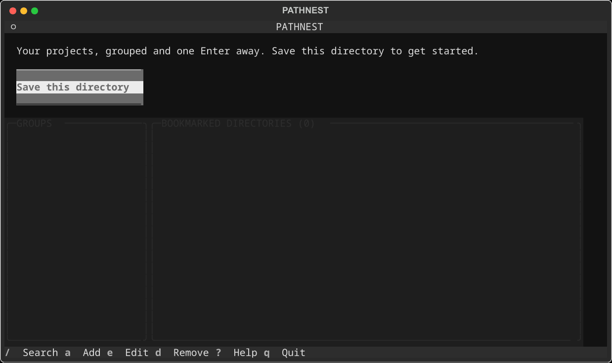

# PathNest


**Your projects, grouped and one Enter away.**

Stop typing long `cd` commands. Save your project directories in groups, pick one, press Enter. Your terminal is now there.



- **Two-panel TUI**: groups on the left, bookmarks on the right, keyboard only.
- **Global search**: press `/`, search names, groups and paths, then Enter to jump.
- **Quick setup**: save your first directory in one form, or scan a projects folder.
- **Shell navigation**: Enter on a bookmark closes the TUI and `cd`s your current shell.
- **One binary, one JSON file**: no runtime Python, no database, no background service.

## Install

### Download a release

Download `pathnest-linux-x86_64.tar.gz` and its `.sha256` file from
[Releases](https://github.com/HosseinBazeghi/pathnest/releases). Release bundles
are produced when a version tag is pushed; if no bundle is available yet, use
**Build from source** below.

The prebuilt bundle targets **Linux x86_64 with glibc 2.35 or newer** (for example,
Ubuntu 22.04+). Bash and Zsh are supported. It needs no Python installation.
For other Linux architectures or older glibc, build on the target machine.

```bash
sha256sum -c pathnest-linux-x86_64.tar.gz.sha256
tar -xzf pathnest-linux-x86_64.tar.gz
cd pathnest-linux-x86_64
./install.sh
```

The installer adds the binary to `~/.local/bin`, installs shell integration and
completion, and appends a guarded source line to your Bash/Zsh configuration.
Open a new terminal and run `pn`. If prompted, add `~/.local/bin` to your PATH.
Zsh completion uses your existing `compinit` setup.

### Build from source

Linux with Python 3.9+ (Fedora: `sudo dnf install python3`). No root required.

```bash
git clone https://github.com/HosseinBazeghi/pathnest.git
cd pathnest
./build.sh
```

`build.sh` builds a standalone binary, installs it to `~/.local/bin`, and sets up shell integration. Open a new terminal and run:

```bash
pn
```

### Updates

```bash
pn update --check
pn update
pn update --version 1.3.0 --check
pn update --version 1.3.0
```

`pn update` downloads the latest **published stable release** from this project's
GitHub Releases page. It verifies the archive's SHA-256 checksum and runs the new
binary's version check before replacing the installed binary and shell wrapper.
Bookmarks and shell configuration files are untouched. Open a new terminal after
updating to load the new wrapper and completion functions.

Use `--version X.Y.Z` (or `--version vX.Y.Z`) to choose a specific published
stable release. Combine it with `--check` to preview the change. Explicit version
selection permits downgrades; plain `pn update` never downgrades. Selecting the
installed version does nothing. The selected release must include the Linux
bundle and checksum; draft releases, prereleases and Git branches are unsupported.
Version selection requires PathNest 1.3.0+: on 1.2.0, run `pn update` first.

Automatic installation supports standalone installations in `~/.local/bin` on
Linux x86_64 with glibc 2.35+. Source/virtual-environment installations can check
for releases with `--check`; use the source build route to update those. An
unpublished commit or tag is not an update: the release must include the binary
archive and checksum. Network failures, missing release assets, or incompatible
binaries leave the current installation in place. Concurrent updates are rejected.

HTTPS uses your system's trusted certificates, with a bundled Mozilla CA list as
a fallback when no system CA file is available. Custom `SSL_CERT_FILE` and
`SSL_CERT_DIR` settings are respected. Certificate and hostname verification
remain enabled; a company proxy may require your administrator's trusted CA bundle.

If **v1.2.0 or v1.3.0** reports `cannot reach GitHub` because of certificate
discovery, supply your system CA bundle once to install the fix:

```bash
# Debian / Ubuntu (also use this path if it exists on your system)
SSL_CERT_FILE=/etc/ssl/certs/ca-certificates.crt pn update

# Fedora / RHEL: use this instead if it is your system's CA bundle
SSL_CERT_FILE=/etc/pki/tls/certs/ca-bundle.crt pn update
```

After upgrading to **v1.3.1 or newer**, ordinary `pn update` commands discover
these certificates automatically. The release archive and `install.sh` are also
available for users whose older updater cannot connect.


## Keys

| Key | Action |
|-----|--------|
| `↑` `↓` | Move selection |
| `Tab` | Switch panel |
| `Enter` | Open group (left) / `cd` to directory (right) |
| `/` | Search all groups; Escape returns to the previous view |
| `a` | Add group or bookmark (first run: save this directory) |
| `e` | Edit selection |
| `d` | Remove selection |
| `?` | Help |
| `q` | Quit, directory unchanged |

On first run, press Enter on **Save this directory**. Its name and path are
prefilled, and the `Default` group is created only when you save.

Search is case-insensitive and matches all typed words across names, groups and
paths. Use Up/Down to select and Enter to jump. Results are capped at 100 visible
rows; keep typing to narrow them down. Search does not scan your disk.

Unavailable paths are marked in the group view. Select one and press `e` to
repair its path. Bookmarks on disconnected drives are retained.

New bookmarks default to the current directory. Paths are validated, `~` is expanded, and names, groups, and paths are all yours to set.

## CLI

Manage bookmarks and navigate without the TUI:

```bash
pn add                                  # bookmark the current directory
pn add --group Research --name Thesis ~/university/thesis
pn go thesis --group Research           # choose a bookmark in a specific group
pn go thes                              # jump using a unique prefix, ignoring case
pn edit Research Thesis --name Paper
pn edit Research Paper --path ~/university/new-thesis
pn group add Personal
pn edit Research Paper --group Personal # destination group must already exist
pn group add Work
pn group rename Research Science        # bookmarks are kept
pn list
pn list Personal --json                  # structured output for scripts
pn update                               # install the latest stable GitHub release
pn update --check                       # check without changing the installation
pn update --version 1.3.0                # choose a specific stable release
pn scan ~/Projects --group Work          # preview immediate, non-hidden subdirectories
pn scan ~/Projects --group Work --yes    # add all candidates without a prompt
```

`pn go` first prefers an exact name, then a case-insensitive exact match, then
a case-insensitive prefix. A unique match jumps immediately, including in
scripts. Ambiguous matches are listed; choose a full name or add `--group`.
Other typos still offer fuzzy suggestions and require confirmation before jumping.

`pn edit GROUP NAME` accepts `--name`, `--path` and `--group`, separately or
together. It requires exact current group/bookmark names. All changes are
validated and saved together; it never renames or moves the actual directory.

`pn list --json` emits the same `{"groups": [...]}` structure as the bookmark
file, optionally restricted to one group. Empty databases produce `{"groups": []}`.
Diagnostics go to stderr so stdout remains valid JSON on success.

Scanning skips names and paths already saved in the destination group, plus
empty or duplicate names after trimming whitespace. At the
preview, enter numbers separated by spaces, `all`, or Enter to cancel. It never
recurses or modifies project directories; selected bookmarks are saved together.
In scripts, scanning requires `--yes` to make changes.

Press Tab after `pn go` to complete saved names, or after `--group` to complete
groups. Completion reads your configured database without changing it, including
when `--config FILE` is present on the command line.

## Data

Bookmarks live in `~/.config/pathnest/bookmarks.json`. XDG aware, atomic writes, created on first run.

New bookmark paths are absolute and retain symbolic links. Legacy relative paths are interpreted relative to the configuration directory; edit any that were saved from a different directory. Concurrent edits are rejected with a retry message rather than overwriting another instance's changes.

```bash
pn --config /path/to/file.json          # or: export PATHNEST_CONFIG_FILE=...
```

## Develop

```bash
python3 -m venv .venv && . .venv/bin/activate
pip install -e ".[dev]"
pytest
```

## Release maintenance

Keep the versions in `pyproject.toml` and `pathnest/__init__.py` in sync. Pushing
a matching `vX.Y.Z` tag runs tests, builds on Ubuntu 22.04, verifies an isolated
installation, and publishes the archive and checksum. `build.sh` remains the
local source-build route; `install.sh` is shared by both installation paths.
`pn update` depends on the published archive name and its `.sha256` file; keep
these assets together. No release is published merely by building locally.

MIT license.
